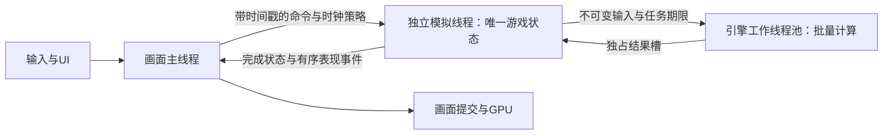

# HardCore 群怪多核架构决策

日期：2026-10-13（Asia/Shanghai）。状态：两轮Pro总设计已经完整回读，当前源码前置核对已完成；独立物理推进接口的封口设计正在交由Pro复核。在这一边界明确前，不称整个大施工已经完全准备就绪。游戏生产改造、原生性能验收和新APK尚未执行。本决策不等于群怪掉帧已修复。

## 目标与依据

把游戏模拟与画面执行分开，让真正的群怪重计算使用多个CPU核心，保持当前游戏的移动速度、战斗节拍、候选选择、碰撞规则、立即攻击、HP、掉落和存档。画面线程读取完成状态；后台任务按明确期限提供数据。300ms仅是现有降低规划工作量的参数，不是架构依据。

与官方Pro已完成两轮讨论，并实际回读报告。主参照为安卓《Deep Rock Galactic: Survivor》。Unity于2026-09-18发布的移植团队访谈记录1000敌人追击、500敌人配合武器持续战斗，采用原生连续数据与群怪运动Job任务链。对方的完整源码、模拟所有权、逻辑频率及实际worker数没有公开；本项目时钟和原序修复不能冒称直接复制自该游戏。

- [官方开发访谈](https://web-prd.hexagon.unity.com/blog/optimizing-deep-rock-galactic-survivor-for-mobile)
- [安卓发行](https://play.google.com/store/apps/details?id=com.ghostshippublishing.deeprockgalacticsurvivor)
- [本轮Pro研究线程](https://chatgpt.com/c/6acddd90-6e4c-83e9-86f0-a3932a895d6c)
- Pro原始设计：`PRO_ROUND2_DESIGN.md`，27849 bytes，SHA256 `d9c07d84a3e3f286572563895421cb575792a812d4bf543003bc17c65abb6076`。

## 选定结构

| 执行者 | 职责 | 数据所有权 |
|---|---|---|
| 画面主线程 | 输入/UI路由、场景与资源生命周期、读取完成状态、提交画面 | 只读游戏状态与表现代理，不独立推进战斗 |
| 常驻模拟线程 | 原逻辑时钟、任务释放和期限、原序移动/攻击/HP/死亡与同步玩法回调 | 唯一可写的战斗状态；不会与旧Node同时推进 |
| 工作线程池 | 路径和候选、批量动态/静态几何、已确定输入的命中数值、表现参数准备 | 输入版本在计算期间不变，每块只写自己的结果 |

模拟线程是独立常驻线程，不长期占用工作池槽。复用Godot Thread与WorkerThreadPool，项目只定义固定处理阶段，不自行建设通用任务系统或整套ECS。高频循环与连续数据优先采用C++/GDExtension，UI、内容配置和编辑器保留原链。

## 时钟与数据交付

画面入口制定有版本的时钟策略与呈现需求，模拟线程按单调时钟的绝对释放时刻运行。不能每个显示帧才给模拟发一次许可，也不能采用“算完再睡固定间隔”的漂移循环。

每项任务明确：输入采样时点、允许开始时点、前置依赖、最晚完成时点、生效tick/phase/ordinal。worker提前完成也不提前生效，晚到不自行改变生效次序。模拟时钟、旧wall-time到期及暂停规则通过明确适配保持原语义，不把它们混成同一份delta。

画面帧和模拟tick分别编号；呈现合同事先定义需要哪一版状态。完整状态发布后才可读，发布点采用短同步。建议三个有所有权的缓冲槽，生产者不能覆盖读者；槽数不表示主动延迟三帧。状态快照与有序攻击/受击/死亡事件分别交接，事件不能随旧快照替换而丢失。

显示流畅、模拟持续落后不满足目标。任务完成、tick完成、输入服务、实际呈现和状态年龄分别记录，不能用worker ready代替真实状态生效。

## 分块与过载

任务按候选—peer判断、地图边测试、索引遍历等真实工作量拆分，而不是按怪物数量或一个模块一条固定线程。有限块数多于worker数，空闲worker领取ready块；块之间不在worker内部相互等待。大任务的独立部分可以继续拆分，依赖链与权威提交不能靠增加线程数消除。

按最早消费者期限、关键路径和工作量组织固定阶段。显式限制参与并行度，给模拟、画面、引擎和系统工作保留机会。手机大小核非等速，不把创建4/8线程当4/8颗同速独占核心。

最迟启动时点为 `任务截止 - 保守执行成本 - 调度干扰 - 安全余量`。worker截止还要给模拟原序提交、冲突修复、结果发布及画面/GPU尾部留时间。任何必要关键路径超过可用期限，说明当前实现或并行配置不满足目标，不能移动deadline使统计变好。

默认当前tick一个在途窗口，最多增加一个同tick前瞻窗口；不累计多个未完成tick。缓冲固定、有界，不截断合法实体或事件。临近截止停止无用投机准备，必要后缀由模拟线程完成；不把补算重新塞回画面线程。正在执行的任务有限结束，完成前不释放输入，不强杀或与串行补算共同写一个输出槽。正确性恢复与该帧按期完成分开判定。

## 保持原结果的提交与修复

当前规则是较早actor提交移动后，较晚actor读取新位置。因此全体以帧初状态算好最终位置再一起写入会改变规则，本路线不采用。

worker保留按原slot/候选顺序排列的数值中间结果与实际读集合。模拟线程维护正式位置、半径、目标/动作、资格、生命期和地图变更。读集合未受影响时复用数值；相交时只修复受影响的peer—候选关系，随后从原方向首选开始执行原短路。不可只检查旧时最终选中的方向。

同bucket移动必须记录pose变更，membership revision不变不能证明位置不变。移动、出生、传送或半径变化使新身份可能进入查询时，重新执行受影响范围的原索引查询，恢复原身份顺序。高冲突密集区缩短前瞻，保留静态和未变数据并行；必须顺序处理的后缀留在模拟线程的紧凑原生路径。HP、RNG及同步玩法回调不由worker投机执行。

## 必须完成的引擎适配

活动Node、UI和渲染资源不作为任意worker的共享对象。场景线程组是引擎process/physics调度的一部分，不能单靠设置SUB_THREAD就宣布模拟独立。

当前4.7官方源码的 `Main::iteration` 执行 `sync → flush_queries → physics_process → end_sync → step`；`step/sync/flush_queries/end_sync` 是内部C++接口，没有在 `PhysicsServer2D::_bind_methods` 绑定。普通GDExtension不能把它当成默认世界的公开手动step。基类及Godot后端的构造函数都会改写全局singleton，直接new第二个服务器也不成立。原文与哈希保存在 `outputs/multicore_v114_20261013/preflight/engine_api/`。这一事实是新增的施工前置核验，不是新性能实验。

自定义运动几何沿原算法数据化。真正依赖活动PhysicsSpace的查询和写入通过有tick身份的PhysicsPort，在合法阶段执行；线程安全不等于立即看到刚提交的状态。若关键移动/攻击仍需画面主循环启动物理step，必须闭合这条依赖，必要时使用保持原求解器与唯一step所有者的引擎适配。未闭合前不验收为完全独立模拟。

输入保留原UI路由、到达序号、时间戳及所见相机身份，在原采样位置服务。只有普通输入入口无法满足目标时，沿原Android转发链增加小型邮箱桥，不创建第二份输入权威。

存档由模拟所有者在一致事务边界产生状态，沿原schema与存储服务落盘、确认；不能因为异步就提前返回保存成功。Android构建绑定实际Godot、API、NDK、模板和浮点合同，保留包名`com.personal.mafaoffline`、原签名和旧存档目录。

角色身份沿现有 `ActorRef` 的 `{world,runtime_id,life_generation}` 及 `world_context` 完整字段，S registry仅迁移解析后端。不能在S访问旧Node weakref，也不能另造第二套身份。现有 `release_id/fact_id/credit/chain`、死亡和掉落去重键不被新tick或命令序号替换。

源码依据：`outputs/multicore_v114_20261013/preflight/state_ownership/STATE_OWNERSHIP_AUDIT.md` 与 `preflight/clock_physics_input/REPORT.md`。接口、时钟、缓冲和回退细则见同目录 `SOURCE_BOUND_DESIGN.md`。

## 施工顺序与完成条件

1. 当前群怪闭环：真实输入、玩家/怪物追击、原绕路/碰撞、移动发布、立即攻击、HP/死亡与同步回调、表现发布。第一阶段包含真正重工作和权威提交离开画面线程，不能只交付空框架。内部先建立串行原生参考，再接工作池。
2. 关闭所有权缺口：当前已实装职业/技能、召唤、换图、复活、装备变化、旧状态与存档。一个会话只能有一个状态所有者；未闭合的会话保持整个旧模式，不能禁止原有技能冒称迁移成功。
3. 批量表现与期限：批算动画、方向、UV、排序键和飘字，按原等距遮挡顺序提交；闭合输入与PhysicsPort依赖，确定生产并行度。

最终需要同时满足：同输入和时间事件下规则一致；模拟与输入按期服务；画面与GPU按期呈现；状态不持续落后；队列和资源有界。这里只确定架构与验收合同，未承诺尚未实现的4/8worker可在REA-AN00上达到60fps。

主树为施工场地，113冻结树保持只读。当前生产改造：NOT_RUN；新APK：NOT_RUN；设备验收：NOT_RUN。本轮按用户要求未增加性能实验。
