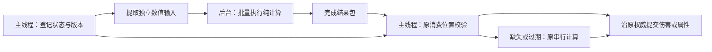

# 状态效果平台与可选后台计算设计

日期：2026-10-13。状态：两轮官方 Pro 讨论与主控源码/解析计算核对完成后的设计；生产实现、线程启用、性能验证及设备验收均为 NOT_RUN。

最终架构决策：建设增量状态能力、事件驱动贡献计划和原消费者接口；保留纯数值执行边界，实际后台执行器不是公共平台完成的必经阶段；不迁移整世界/整角色更新。当前已有点燃保持串行。两轮讨论原文、主控质询、源码指纹和计算见 `outputs/effect_architecture_pro_20261013/`。

## 1. 目标与范围

用户希望先搭好公共平台，之后逐项接入自己设计的 buff/debuff 数据。平台先避免不必要的重复计算；足够重且允许提前计算的任务才考虑移出主线程，让主线程在规定时机取得正确结果，为输入、战斗提交、动画和画面呈现保留时间。60 FPS 是目标设备上的验收目标，不是开启线程后的保证。

本设计在已授权的 v113 研究树中形成；主树不修改。后续框架研究和测试仍先放 v113，是否进入独立新游戏主树，需要明确的集成指令，不能自动合入两条产品线。本稿不接入新技能、装备、地图、存档数据或新的实际状态效果，不把现有 DOT 强制改为每秒一次。

已知玩法意向：单怪同时不超过六种 debuff；破甲考虑叠层，点燃考虑叠层或覆盖，流血覆盖，感电覆盖，冰冻影响移动和攻击速度，麻痹已有实现。这些是未来内容约束，不等于把现有所有状态容量从 16 改成 6。点燃最终叠层方式、周期、系数、上限等由用户逐项设计；平台不能替用户补出默认玩法。

2026-10-13 用户最新范围约束取代此前批量施加假设：引怪仍可能同时有30/40甚至更多参战怪，怪物战斗系统保持原负载；debuff单独按实际作用目标计算。未来批量来源包括局部光环及带状态的局部技能。buff光环范围最多9格，debuff光环最多5格，debuff光环局部同时受影响按10–15只怪物设计，通常分批进入。技能示例为冰咆哮带减速，一次最多9格命中范围，只给本次真实命中的目标施加；不按引怪列表或仇恨列表全体施加。范围格数不是目标只数，不推断9格等于9只怪；原话光环“5格/9格”也暂不自动解释成半径或正方形边长。

30/40怪仍是现有战斗基线，不再给其全部怪物同帧新增六种debuff。平台验收使用10/15个受影响目标、逐步进入/离开、已声明的叠层和覆盖、到期及周期结算。不以“随机错开tick”修改效果规则；分批进入只改变负载模型，具体周期相位遵守未来效果合同。

光环与技能分别建场景：10/15目标是用户给出的5格debuff光环负载；冰咆哮按其正式9格命中范围和其中实际对象数验证。技能可以在同一次局部命中中施加减速，但不将所有参战对象人为列为本次目标，也不为满足光环目标数截断技能命中。

## 2. 当前基线与已有能力

工作区：`C:/Users/Administrator/.codex/worktrees/milestone-v113-frozen/HardCore`。
分支：`codex/milestone-v113-frozen`。
HEAD：`bd73a256493bf41f9c75c19998c84792f74e2262`。
读取时 dirty 197；源码事实以此 HEAD 加当前工作区字节为准，不能只用提交号代表受测来源。

| 已有入口 | 当前能力 | 设计中的处理 |
| --- | --- | --- |
| `scripts/features/runtime/effect_runtime.gd` | 已接受状态、队列、预约容量、DOT 调度、资源和来源生命周期、结算回调重入保护 | 保留为状态及周期结算权威，在其边界接入计算辅助模块 |
| `scripts/features/runtime/indexed_due_heap.gd` | 每效果一个可更新条目；同到期时间按稳定序号排序 | 保留原消费顺序，不能用线程完成顺序替代 |
| `scripts/features/handlers/handler_registry.gd` | 当前注册点燃、吸血、死亡爆发三种 handler | 由正式注册/编译链逐项扩展，不能宣称已有六种通用状态实现 |
| `scripts/features/handlers/ignite_handler.gd` | 点燃纯命令生成；当前同种替换，目标防御每 tick 采样 | 保持当前规则，新增叠层策略必须显式声明并验证 |
| `scripts/features/contracts/plain_graph.gd` | 深复制并冻结纯数据，拒绝 Node、Callable、循环和非法值 | 复用定义边界；运行热路径使用已验证的紧凑数值包，避免反复冻结整个世界 |
| `scripts/layers/runtime/combat_runtime_service.gd` | 当前免疫、防御、伤害及实际 HP 提交入口 | 保留最终结算权威；后台结果只是计算结果，不是扣血许可 |
| `scripts/layers/rules/modifier_effect_runtime.gd` | 属性纯计算工具，支持已有操作与条件 | 不把它误当成已有的临时 buff 生命周期系统，不建立第二套最终属性权威 |

现有普通中毒默认 1 秒周期，道士绿毒配置为 2 秒；扩展点燃的周期从配置取得。现有效果运行时已使用到期堆和帧预算消费，存在 lateness 指标。新设计必须同时报告计算提前完成率与实际结算延迟，不能把“后台按时算完”冒充“游戏按时扣血”。

### 相关输入指纹

| 路径 | SHA256 |
| --- | --- |
| `scripts/features/runtime/effect_runtime.gd` | `6e97252645cce2fea271d8ba1cce861661d06533481daeb4d17f954e7848e31f` |
| `scripts/features/runtime/indexed_due_heap.gd` | `3b597a2affcc75248f8aa3cee13cc1cf40e5f21e7a784e80f09df9260f08be97` |
| `scripts/features/handlers/handler_registry.gd` | `1c14977405b7f6aabcbd658d55084dfcda1e2bc9d4d34a6c016c532a97c219fd` |
| `scripts/features/handlers/ignite_handler.gd` | `2515e2d9ff13ba2713ba4bd31105d701cb791ac89c5a87feb005a7c93d4d325a` |
| `scripts/features/contracts/plain_graph.gd` | `b10dc7b24f5126acdfa1bdae182c6200eab65c233a70d7eb7a63ac84ad72057c` |
| `scripts/features/adapters/feature_authority.gd` | `36e62025d0863037241d333fe33dc00ed957327b5f298bd0b4ed000bfaa1efd1` |
| `scripts/layers/rules/modifier_effect_runtime.gd` | `33f51459c7b11ee073b3a40ee7f601769c1a044036d414bcc5ebf68d0f17c5e2` |

## 3. 计算与生效分离

### 3.1 三类工作

**即时状态与战斗提交。** 砍刀命中、移动阻挡、HP、死亡、免疫、减速/麻痹的生效和解除等，仍由主线程在原生产位置处理。不会因为后台繁忙而延后一帧，亦不会先提交一份过期属性。纯数值部分只有已提前完成且依赖未变化时才可替换原计算。

**有固定到期时刻的效果。** 持续伤害和持续治疗可以按内容配置的周期消费。可冻结部分提前计算；在结算时采样的防御、免疫及其它动态状态保持原采样位置。周期为游戏规则，准备提前量为调度参数，两者独立。不能宣称 1 秒周期总有完整 1 秒的可用计算窗口。

**允许稍后使用的准备数据。** 纯数值系数组合、未来效果包准备、非关键说明等可以在截止期限内后台处理。新类型先登记允许延迟的合同，未声明的数据不得默认延迟。地图几何或 AI 规划只有证明输入快照独立、结果依赖可检查后才能作为独立消费者接入；本阶段不搬动其生产流程。

### 3.2 数据流



主线程提交游戏事实；后台只返回数值及身份信息。没有后台 HP、第二个技能规划器、第二套状态时间或后台人物状态。

## 4. 模块边界与接口

以下是拟定的接口职责和字段，不是已经登记到生产的稳定 ID。

### 4.1 效果定义/编译边界

沿现有 authoring → 编译 → 权威注册 → 已接受 binding 链路扩展，不手改生成 catalog。每种未来效果声明：

- 稳定效果 ID、handler ID、适用角色和来源；名称只用于显示。
- 生命周期类别：周期效果或临时属性效果；时间域使用现有 simulation clock。
- 持续时间、周期、首次 tick、到期与 tick 同时发生时的顺序。
- 同种重施加策略：刷新时间、覆盖数值、增加层数，以及二者的显式组合；上限及封顶后如何刷新由定义决定。
- 叠层计时策略：共用截止时间或逐层截止时间。先支持明确声明的共用时间模型；不能静默把逐层计时降为共用计时。
- 数值的采样点：施加时快照或每次结算时读取；舍入、整数范围和属性操作顺序。
- 哪些依赖能冻结，哪些必须在原消费位置读取；纯计算 kernel 的登记和输入输出模式。
- 对应资源、表现、来源退出、地图退出、死亡及存档重建合同。

简单效果可以只改配置；新的行为、触发链或没有注册的计算操作仍需一个小的 handler/adapter 和针对性验证。平台不承诺所有新玩法都能只填表，也不预建任意脚本表达式执行器。

### 4.2 状态所有者

扩展现有 effect runtime 的已接受状态模型，而不是新建平行状态表。增加计算所需的状态版本和依赖版本；版本只在相关输入变化时推进。层数、时长、next_due、来源与状态回收仍由同一个权威修改。

新临时属性效果在这里拥有生命周期；最终属性仍沿现有 player/combat 属性消费者接入。只在施加、叠层、覆盖、解除、到期或已登记的依赖变化时标记派生数值失效。消费端不能把属性更新无限留在后台；若第一次即时读取尚无有效结果，运行同一串行 kernel。

已有 Enemy poison/control/charm/rage、Player AC/MAC、Summon AC/MAC/stealth、PlayerState 临时物品 buff 各自保留现有推进权威。部分旧红毒消费使用 wall clock；本阶段不把它改成 simulation，不在新 runtime 中重复保存强度/剩余时间。未来单效果迁移须显式转交状态、消费者及存档合同，并停掉旧推进路径。

派生属性按登记的依赖组（例如防御、魔防、移动速度、攻击速度）失效，不建立任意规模的运行时 job 图。权威数据变化后、可能重入的回调之前推进受影响组版本。只合并两次真实观察之间的派生重建，不能帧末合并施加、伤害或驱散事实。结束效果时从既有基值和当前有效贡献按 canonical 操作顺序重建，不用通用“减回去”撤销 multiply/override。

当前所有 actor 的属性写入口没有完整版本覆盖证明，第一版不缓存跨时间的旧 target 防御/免疫。只对已登记的新贡献及依赖做派生聚合；未覆盖写入口、未知回调及旧 wall-clock 路径继续 live 读取。

第一版主要缓存新贡献的有序计划及与live base无关的稳定参数；最终值原则上只属于当前同步读取。从原消费者本次canonical base/context开始，按计划求值，避免把旧基础值偷偷冻结或把base中已有贡献再施加一次。只有写入口完整且验明等价的特定组才可进一步缓存最终值，不宣称全体actor属性已经事件化。

拟定三个职责接口（不是已实现API）：`accept_status_change(command, accepted_context)` 沿原接受边界更新唯一状态；`invalidate_registered_input(target_ref, dependency_id)` 由已登记写入口使相关组失效；`read_effective_group(target_ref, group_id, live_base, live_context)` 在原读取位置保障期限、准备贡献计划并求当前结果。串行纯函数是可选后台执行的共同参考。

### 4.2.1 临时属性到期与历史 DOT 义务

现有 heap 消费者只执行周期伤害。新临时属性须有显式的 expiry 事件类型或原属性读取屏障；不能靠下一个 DOT tick 才移除已过期的减速。读取前由唯一所有者处理原到期边界，或验证由权威期限派生的 valid_until，不能新建另一套 TTL。

第一版 typed expiry 只负责新临时属性；现有 Ignite 状态仍走原 _tick_one/最后合法 tick 后停止的路径。不得将新的 expiry 清理挂到同一个旧 Ignite head 上，抢先删除 next_due<=expires 的历史义务。当前正式编译器要求 Ignite duration>=period 且 duration 是 period 的整数倍；2.5秒持续/1秒周期或0.5秒持续/1秒周期会被拒绝，它们不是当前合法点燃的生产 bug，只是泛化到临时属性时的反例。

新属性读取屏障只排除本目标、相关组的失效贡献；typed expiry随后负责幂等收尾。两者由同一owner处理，不能重复解除或让旧expiry票据删除同handle的新实例。第一版到期操作限定为已注册的属性解除，不在getter内部隐含on_expire伤害、反击或任意回调。贡献边界由定义显式声明；fixture可使用[apply,expiry)，不把它当成所有新效果的隐藏默认。

未来某个新效果若同时具有属性贡献和周期伤害，须显式区分“属性当前是否生效”与“仍待服务的原合法历史义务”，二者仍由同一已接受实例持有；在义务和生命周期全部终止前保留所需来源/租约。需要独立的顺序验证后才能支持，不能把全部清理绑在一个 erase 上。

第一版不建设上述混合生命周期，只记录扩展边界。历史tick保留原due身份，不保留历史防御快照；实际service仍按原per_tick规则采样。欠账数量也不等于无条件补扣次数，死亡、替换、免疫和runtime退休继续沿原判断处理。

### 4.3 计算请求包

请求包含 world/runtime generation、目标的已有生命期身份、效果 handle、状态版本、定义/数据版本、依赖版本、原结算序号/到期时间、已登记的 kernel、以及它真正需要的数值。

禁止把节点、WeakRef、SceneTree、实时共享 Dictionary、正式状态对象、GPU/物理资源或任意外部回调交给 worker。输入包与输出槽生命周期独立持有，不在后台读取完之前复用内存。仅仅调用 `make_read_only` 不等于已经证明所有引擎资源可跨线程共享；接口从构造时限制为纯值，生命周期仍需测试。

### 4.4 执行器与结果

同一个已注册纯 kernel 支持串行及后台调用。每个批次只处理独立状态的纯数值部分；共享目标 HP、逐次伤害后的属性、死亡触发、吸血和链式效果不属于独立并行部分。

结果返回请求身份、输入版本、每项数值/错误以及完成计数。未知 kernel、字段冲突、非有限数、越界及不符合输出 schema 显式拒绝，不能用默认伤害掩盖错误。后台不调用正式伤害端口，不推进 effect heap，不决定死亡/归属，不发布表现。

### 4.5 主线程消费

仍在原权威的原消费顺序逐项校验目标生命期、world generation、效果是否当前、状态和依赖版本、tick 序号及结果范围。通过后只替换已证明等价的纯计算部分，继续原伤害和属性入口。

旧结果作废只是丢弃计算副本，不能丢掉权威队列里合法的 tick。消费后登记该序号已消费；迟到结果不得再次扣血。一次提交触发驱散、死亡、换地图或回调重入时，后续结果重新检查当前状态，不能整包预先批准。

现有点燃每 tick 采样魔防并有逐 tick 独立 RNG。第一阶段不会提前冻结这份魔防，也不会改变现有随机数身份或调用顺序。只有证明相同 seed、相同采样输入、相同调用顺序的独立部分才能迁移；共享 RNG 保留主线程。

## 5. 可选后台执行器的调度与不等待策略

仅在纯 kernel 已有完整净收益依据后，首个后台候选使用 Godot WorkerThreadPool，最多一个本平台计算批次在运行。复用引擎线程池，不每个怪物建线程，不按“十怪一线程”划分，也不根据 PC 核心数默认占满手机。当前建设范围只保留执行边界，不把真实 worker 接通作为平台完成条件。

队列以既有合法状态/容量为边界，只保存每个待准备项的当前请求；同一未派发状态多次变化时合并为最新版本。已经开始的输入不得修改；其结果允许失效，完成后回收。计算准备元数据不是第二个到期权威，实际 tick 仍由原 effect heap 发放。

紧邻期限的周期准备优先于可延后的说明/未来数据。批次大小和提前量根据目标机的计算耗时、准备成本及期限完成率确定，不能用任意定时器去延迟玩法。任务中每项独立、批次有上界，避免一个非关键大任务占住后台。

帧内只检查完成状态；确认完成后调用 completion API 回收任务，并取得输出。在任务未完成时，不调用阻塞等待，不自旋，不用锁把计算锁住。使用未运行/已完成状态及独占输入输出槽交接；禁止多个线程同时写同一槽。若有细小发布元数据需要锁，主线程只能使用非阻塞获取并在失败时走原计算，不能持锁执行 kernel。

期限到达后：结果有效就使用；忙、缺失、过期或后台禁用就运行同一串行 kernel，再沿既有队列和预算规则结算。这个机制保证不等待后台，不保证串行回退永远便宜；回退率高意味着该任务不适合后台，需停用其后台派发。不能为了降低回退而推迟合法伤害。

按最新约束，debuff的批量变化主要来自最多5格的光环，10–15个局部目标通常逐步进入。施加按进入、退出、已声明层数或强度变化驱动；不每帧向所有未变化目标重复提交同一施加命令。范围资格仍使用正式空间查询/命中消费者，不另建网格或猜测距离，不省略合法目标。未来光环的持续刷新、离开范围失效以及是否留下持续效果，由该效果合同明确，本平台不擅自选择。

局部技能附加状态复用正式目标选择与命中结果，在已声明的触发边界向状态入口提交，不为debuff再扫描整张地图或重新做同一套技能几何。命中触发、正伤害触发、零伤害/免疫和目标死亡后是否接受状态由具体handler合同确定；不能把未来减速直接套进现有Ignite的actual_loss>0触发门。

局部10–15目标的实际到期仍保持原时间和顺序；分批施加不等于周期结算绝不重合。只验证这一局部规模及实际合同，不再将30/40怪全体同帧新增效果作为验收负载。若提交成为瓶颈，再定位对应重复工作；不能擅自错开扣血时刻、合并逐次伤害或漏结算。

暂停时 simulation 不推进，后台已经计算完的副本可暂存；不使用 wall clock 让效果偷走时长。离开地图、退出战斗所有者、换档或退出应用时推进相关 generation，禁止旧输出回流。任务不接触退出的节点；独立输入输出须保留到任务完成后回收，不能只取消状态就释放正在使用的缓冲。

Godot 每个线程池任务最终需要 completion 回收。帧内只回收已完成任务；应用终止时在停止游戏逻辑后的关闭阶段处理剩余纯任务，而不在正常战斗帧强制 join。后台 kernel 必须有限且无内部等待，避免 shutdown 永不完成。

第二个并行批次/worker 仅在手机实测有净收益且未挤占引擎关键工作后开放。扩展按独立数值项划分，合并保持原序号；不会改成以角色为单位并行执行完整战斗。

## 6. 60 FPS 的性能边界

60 FPS 对应约 16.67 ms 的呈现帧间隔。物理 tick、脚本 CPU、渲染 CPU、GPU、系统调度与手机温控分别影响帧表现；不能把它们全部当成可以由本平台使用的 16.67 ms。

本平台报告主线程输入提取、派发、完成检查、结果验证、正式提交、回收和回退的完整成本，以及 worker CPU、提交到完成延迟、原期限前有效完成率、过期和重复计算、忙时回退、队列/内存峰值、实际 tick 服务延迟。

没有后台执行器时，先报告A的无新效果开销、贡献计划重建次数、live求值成本、最大quantum和真实服务延迟。单个heap节点可能持有多个历史tick义务，队列压力应同时报告最老due与欠账数，不能只看heap size。wall指标若以首次观察due为起点，须标为“观察后等待”，另记pump调用间隔；不能冒称精确due的wall延迟。

主要比较量：同负载下主线程这段完整成本是否下降，同时结果一致、完成量不减、结算延迟不恶化。总 CPU 增加也要明确披露；如果增加带来手机温控降频和持续掉帧，该后台模式不可接受。纯计算少于交接成本的效果保持串行，不强求所有效果后台化。

当前 pump 使用普通 Budget.begin，进入默认 BACKGROUND，project.godot 指定1200us；PROGRESS 6000us是另一个通道，当前效果不会自动获得它。额度是准入账本，不是单 quantum 的硬切断，也不是全游戏 CPU 上限。先分类 budget/fairness拒绝、实际 quantum成本、队列年龄、due/service延迟和呈现帧余量，再决定是否需要调整分类或预算；本稿不将1.2直接改为6，不强制全部 necessary。后台完成不能替代正式服务机会。

每个原实际需要的纯计算成本为K_i，U是原合法消费位置前完成、仍有效且真正被采用的结果集合；新增主线程总成本为H_main，竞争影响为Delta_main：

```
主线程净节省 = sum(K_i, i in U) - H_main - Delta_main
```

同质批次才可写成 n*(q*k-p-v)>d+r；k/p/v是每项计算/准备/验证成本，d/r是每批固定成本。异构包必须逐项或按工作量加权，不能拿数量ready比例乘全体平均K。另记名义due前完成率和原service消费时采用率：晚于due但赶上原合法service的结果可以替代计算，不能标为伤害按期结算，也不能故意推迟service等后台。

## 7. 分阶段搭台交付

1. **契约和唯一所有者。** 完成新状态的定义/编译、刷新/覆盖/叠层及typed expiry合同、状态实例身份和接入接口。既有状态计时和技能数据不迁移；用测试定义验证平台能力。
2. **事件驱动派生属性与串行参考。** 登记小型依赖组、变化时失效、原消费者读取屏障、按canonical顺序重建；建立只收纯数值的可选执行边界。未设计具体数据的能力保持未注册，不主动填上玩法。
3. **真实流程测试与压力验证。** 使用当前生产状态/伤害入口建立完整 fixture，覆盖效果变化和同到期批量提交。测试内容不进入正式技能数据。正确性通过、接口和负载边界闭合后，串行状态平台即可作为完整交付；不要求存在worker。
4. **逐效果接入。** 用户确认一种效果的公式和规则后，配置、编译、接消费者、专项/相关回归。新增叠层或控制效果不借平台实现阶段擅自上线。
5. **条件性后台候选。** 仅当某个具体kernel足够重、输入可提前确定，并有完整两端成本/期限依据时，才实现单后台批次、完成回收、版本拒绝和原消费位置串行回退，再比较优化后的串行平台。当前Ignite原始伤害已预备，seed缓存/对象池/worker都不列为本平台必交项。

没有获得净收益和正确性证据的 kernel 不作为生产性能优化启用。线程存在与性能已改善分别交付。实际不需要后台执行器时，不以“可扩展性”为由继续建通用job图、ECS或世界快照流水线。

## 8. 验证和交付条件

### 正确性

- 纯输入和输出校验，串行/后台结果、舍入和稳定顺序一致；注册未知值显式拒绝。
- 同种覆盖、刷新时间、叠层封顶、相关属性变化、不同效果共存、到期边界、驱散和零值。
- 计算期间再次施加、相同目标死亡后同槽重生、地图切换、暂停/恢复、换档、所有者回收及回调重入。
- worker 早完成、恰好到期完成、晚完成、运行失败、后台禁用、批次容量已满；后台完成顺序不同仍保持原消费顺序。
- 旧结果拒绝、合法 tick 仍结算、一次 tick 不重复提交；不能修改现有伤害、死亡归属、DOT 不打断受击等合同。
- 任务完成及退出回收，没有遗留任务、缓冲复用冲突、不断增长的队列或资源泄漏。
- 已有点燃/周期效果/归属/退役/child-chain 相关回归按相关源码指纹复用或必要复测；不把 handler 微测试当完整生产验收。

### 性能和目标机

保留已保存30/40怪的相同战斗基线，并仅在其中设置10/15个光环受影响目标，按正式范围资格分批进入/退出，覆盖重复资格检查但效果输入未变化、层数变化、覆盖、解除、到期及周期伤害。技能不模拟成给30/40怪同帧新增debuff。局部每目标最多六种负面效果；其中点燃/流血才作为两种DOT候选，六种不全部虚构成周期伤害。

另设冰咆哮9格正式命中范围的局部减速场景，保存完整实际命中集合；验证同一次伤害/命中流程的目标复用、状态触发及解除。整体参战量、范围内命中量、本次新增/覆盖量、活跃状态量和实际周期due量分别计数，不把它们混成一个“怪物数”。

若两种DOT都按1秒周期的设计假设，10目标为20项/秒，15目标为30项/秒；10/15目标六种负面效果分别为最多60/90个种类head的容量场景，不等于每秒60/90次伤害，也不代替既有16状态容量及层模型。具体周期不在本稿决定。

区分现有战斗基线、局部增加效果后的串行基线、将来相同效果的后台候选；不会把有debuff并行与无debuff旧版本混成提速百分比。buff光环9格按后续定义及实际接收者验证，不从范围数字杜撰对象上限。离开范围后若有持续保留效果，其累计head另按正式生命周期记录，不将当前范围资格人数冒充全世界持久状态硬上限。

记录串行/后台 CPU 完整分项、完成数、P50/P95/P99/最大呈现帧间隔、计算服务延迟、实际 tick 服务延迟、队列、内存、过期率和截止前有效完成率。PC 可比测试后在荣耀 REA-AN00 验证持续战斗、温控及主观流畅性。使用每 1 秒周期时不能只测一次 tick 或只测分散到期。

普通 Godot 测试按官方 runner、独立用户数据和 30 秒场景期限执行，已登记的重场景才使用 60 秒。原生测试期间固定受测源码；新增场景通过正式 tracked-path 门禁，不修改真实用户存档。所有结论绑定源码/引擎指纹、命令、invocation、原生退出与完整 receipt。

### 当前交付状态

本稿是设计交付。生产代码与新内容未修改；并行平台 IMPLEMENTATION: NOT_RUN；correctness tests: NOT_RUN；performance comparison: NOT_RUN；APK: NOT_RUN；DEVICE TEST: NOT_RUN。实现前需完成具体实施计划并固定源码基线；不因本设计存在就宣称线程已接入或保证手机 60 FPS。

## 9. 官方 API 依据

- [WorkerThreadPool](https://docs.godotengine.org/en/stable/classes/class_workerthreadpool.html)：支持批量/普通任务和完成检查，任务需要最终 completion 回收；短任务可能被派发成本抵消。
- [Thread-safe APIs](https://docs.godotengine.org/en/stable/tutorials/performance/thread_safe_apis.html)：活动场景树不能作为可随意跨线程读写的输入，GPU/资源操作也不能混入本平台纯数值 kernel。

API 行为来自当前官方文档；实施时仍需核验本项目固定 Godot 引擎版本上的实际行为。文档示例里的立即等待不是本平台的帧内消费策略。

## 10. 两轮审查与最终证据等级

官方会话：https://chatgpt.com/c/6acddd90-6e4c-83e9-86f0-a3932a895d6c 。第一轮读取本轮六份源码摘录和初稿，第二轮实际回应主控八项质询及八份当前源码摘录。完整原文分别保存 `R1_PRO_REPLY.md` / `R2_PRO_REPLY.md`；二者都是本轮读取的官方Pro结果，不是历史回复或本地模型代替。

解析数量、同相位峰值、异构采用成本反例及合法时长条件已独立复算，见 `LOCAL_CALCULATIONS.md`、`MATH_CHECK.json`。它们证明工作量和门槛，不提供Godot/手机耗时。第一轮非法Ignite配置反例的边界在第二轮已更正，本稿没有据此登记现有生产bug。

两轮Pro原文基于当时30/40怪批量效果假设，原文保留为历史审查，不宣称Pro已经审过用户随后新增的光环限制。最新10/15目标计算及验收范围见 `AURA_SCOPE_UPDATE.md` / `AURA_SCOPE_CHECK.json`。缩小后的实际新增负载进一步支持“串行事件驱动先行、worker按需”的决定；这仍不是具体耗时或FPS测量。

架构分析与交付：PASS。受审源码匹配：PASS。原生正确性、native性能、worker实际启用、APK与设备：NOT_RUN。K、交接成本、真实采用率、手机帧间隔及温控数据：MISSING。这个证据边界不妨碍选择A作为最小建设路线，但不允许承诺某个提速比例或稳定60FPS。
